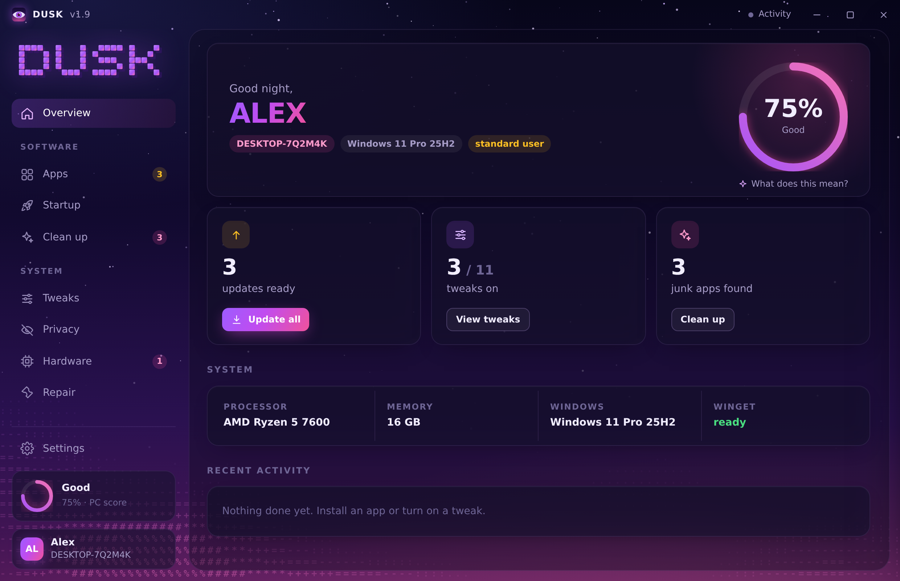
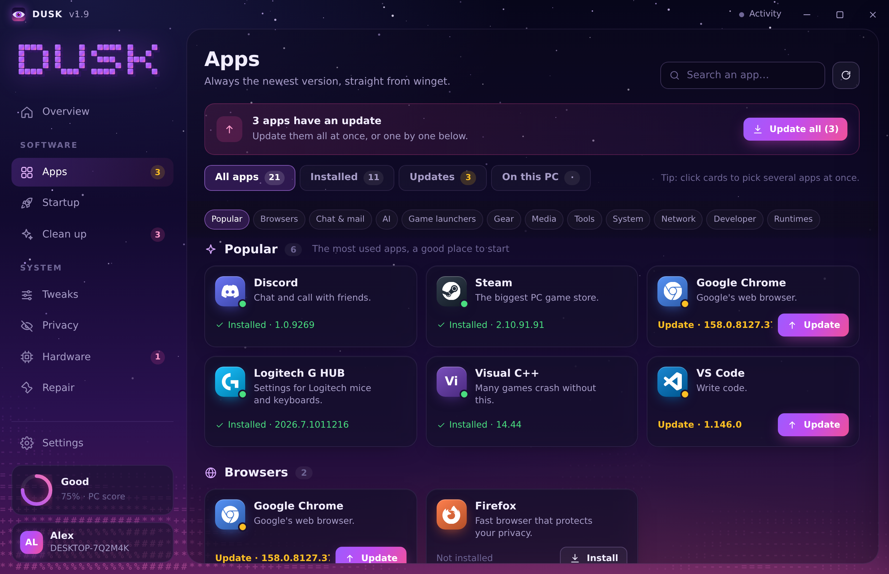
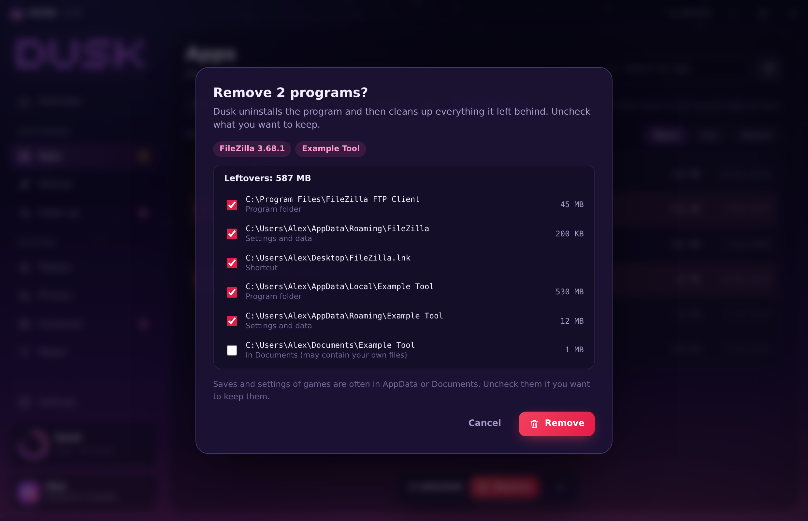
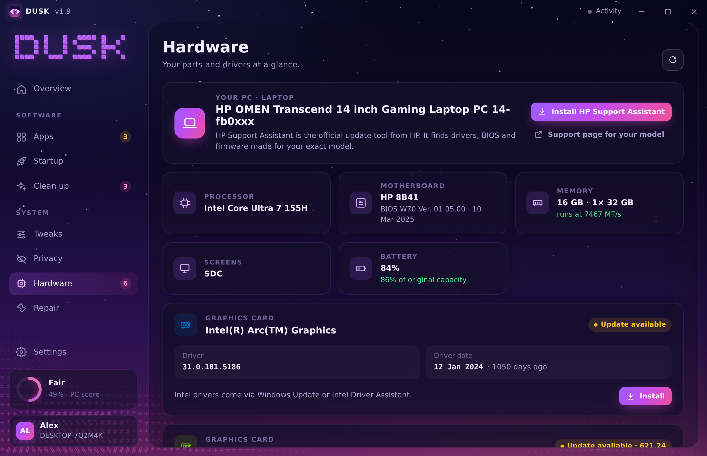
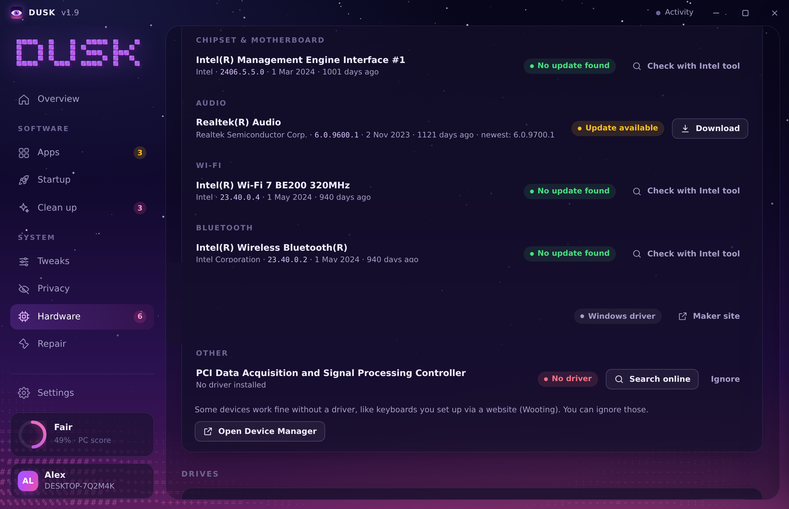
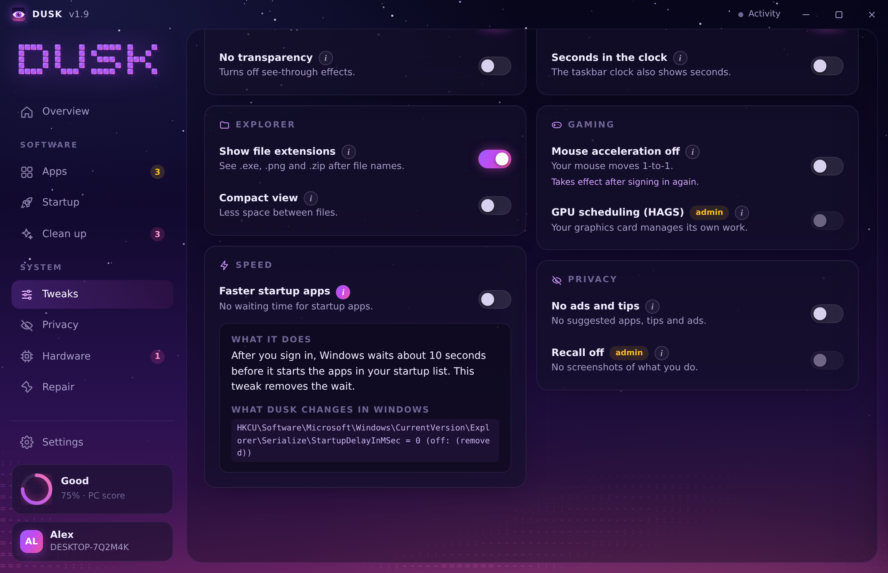
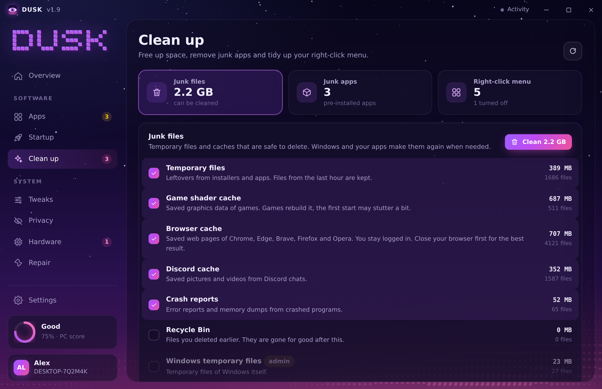
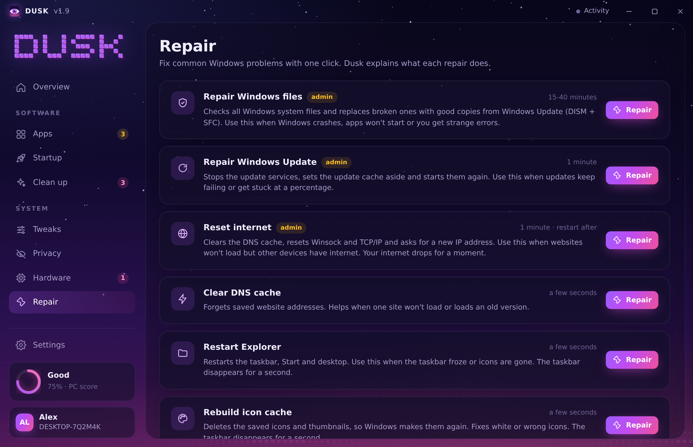
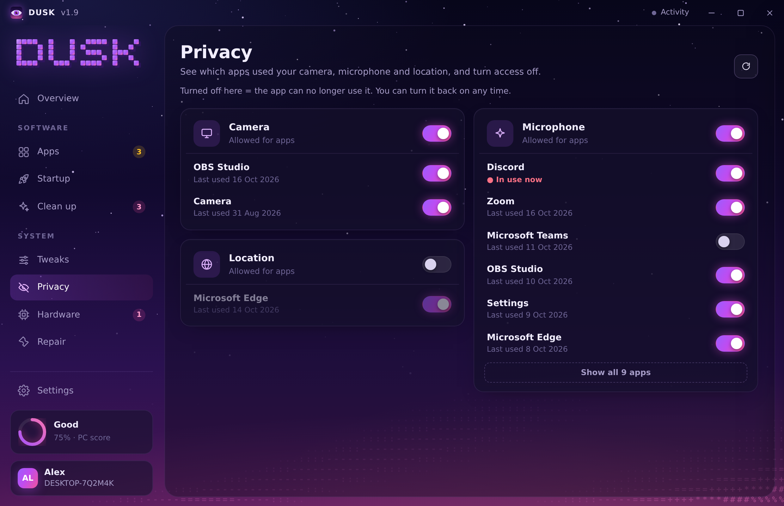

<p align="center">
  
</p>

<h1 align="center">Dusk</h1>

<p align="center">A small Windows toolkit to install and update your apps, tweak Windows,<br>check your drivers and clean up. All in one portable .exe.</p>

<p align="center">
  <a href="../../releases/latest"><b>Download</b></a> ·
  <a href="#screenshots">Screenshots</a> ·
  <a href="#building">Build it yourself</a>
</p>

---

I got tired of setting up Windows by hand every time: downloading the same apps from ten different sites, hunting for the right drivers, flipping the same settings, removing the same junk. Dusk does all of that from one window. No installer, no account, no background service. Download it, run it, close it when you're done.



## What it does

**Apps**
- 140+ apps (browsers, chat, AI, game launchers, media, dev tools, runtimes) installed through [winget](https://github.com/microsoft/winget-cli), so you always get the official, newest version.
- Shows which apps you have and which ones have an update. Update everything with one click.
- *On this PC* lists every program on your computer, also the ones that aren't in Dusk.
- Uninstall programs **and** the folders they leave behind (Program Files, AppData, ProgramData, shortcuts). You see every folder first and can untick what you want to keep.
- If an update fails because another program is using its files (Discord holding OBS's virtual camera, for example), Dusk tells you which ones and can close them for you.

**Hardware & drivers**
- Recognises the PC: HP, Dell, Lenovo, ASUS, Acer, MSI laptops, Surface or a custom build.
- Lists every part with its driver and tells you if it's missing, old, or if there's an update.
- Checks Windows Update, NVIDIA's driver service and AMD's releases. On HP machines it uses the same reference list as HP Image Assistant.
- Points you to the right tool for your brand (HP Support Assistant, Dell Command Update, Lenovo Vantage, …) and can install it.
- Warns you when your RAM runs slower than it's rated for (XMP/EXPO off), shows disk health and battery wear.

**Tweaks**
- 80 Windows settings in plain language: dark mode, classic right-click menu, no ads in Start, mouse acceleration off, Game DVR off, Copilot off, Ultimate Performance power plan and more.
- Every tweak has an **i** button that explains what it does, why, and exactly which registry values Dusk changes. Everything can be turned off again.

**Clean up**
- Temp files, shader caches, browser and Discord caches, crash dumps, the recycle bin.
- Pre-installed apps you probably don't want (Clipchamp, Bing News, Candy Crush, …).
- Right-click menu items that apps added, including the new Windows 11 menu.

**And**
- Startup apps on/off (driver and Windows parts are hidden so you can't break anything).
- Privacy: see which apps used your camera, microphone and location, and turn access off.
- Repair: Windows files (DISM + SFC), Windows Update, network, sound, Bluetooth, printer queue, search index, clock, icon cache and more.
- Save your apps and tweaks to a `.dusk` file and load it on a new PC.
- English, Dutch, German, French and Spanish.

## Screenshots

| | |
|---|---|
|  |  |
|  |  |
|  |  |
|  |  |

## Download

Grab `DuskApp.exe` from the [latest release](../../releases/latest) and run it. That's it.

**Windows says "Windows protected your PC".** Dusk isn't code-signed (certificates cost money), so SmartScreen doesn't know it yet. Click *More info → Run anyway*. If you'd rather not trust a random exe, all the code is right here in this repository and you can build it yourself (see below).

Requirements: Windows 10 or 11 (64-bit). Dusk needs WebView2 and winget; if one of them is missing, Dusk offers to install it.

Some things need admin rights (a few tweaks, driver installs, repairs). Dusk asks Windows for permission when it needs it, or you can restart it as admin from Settings.

## Is it safe?

Fair question for a tool that changes Windows settings.

- Every tweak shows exactly what it changes and can be turned back.
- Settings → *Create restore point* before you go wild.
- Uninstall cleanup only touches folders named after the program, never shared folders like `Microsoft`, `Common Files` or your game libraries, and never your Documents unless you tick it.
- Drivers, Visual C++ and .NET runtimes can't be uninstalled from Dusk.
- Dusk doesn't send anything anywhere. The only network requests are winget, Windows Update, NVIDIA/AMD/HP driver info and the update check against this repository.

Some antivirus programs flag new unsigned tools that run PowerShell and edit the registry. If that happens, it's a false positive. All the code is in this repository.

## Building

You need Go 1.27+ and [go-winres](https://github.com/tc-hib/go-winres). No Wails CLI or Node needed, the frontend is plain HTML/CSS/JS.

```sh
go install github.com/tc-hib/go-winres@latest
go-winres make --in winres/winres.json --arch amd64
GOOS=windows GOARCH=amd64 CGO_ENABLED=0 go build -tags desktop,production -trimpath -ldflags "-s -w -H windowsgui" -o DuskApp.exe .
```

Cross-compiling from Linux or macOS works fine.

Handy flags for testing:

```
DuskApp.exe --check        prints what Dusk sees (apps, tweaks, junk) without changing anything
DuskApp.exe --no-intro     skip the intro animation
```

To work on the UI without Windows, serve `frontend/` with any static server and load `dev/mock.js` first. It fakes the Go side.

## Project layout

```
main.go, app.go        window setup and everything the UI can call
catalog.go             the app list, tweaks and junk apps
winget.go              reading winget output, install/update
hardware.go, devices.go, oem.go   hardware scan, driver checks, HP reference files
uninstall.go, programs.go         uninstall + leftover search
tweakinfo.go           the long explanation behind every "i"
frontend/              the UI (no framework)
```

## License

MIT, see [LICENSE](LICENSE).

Dusk is not affiliated with Microsoft, NVIDIA, AMD, HP or any app in the list. App names and logos belong to their owners.
